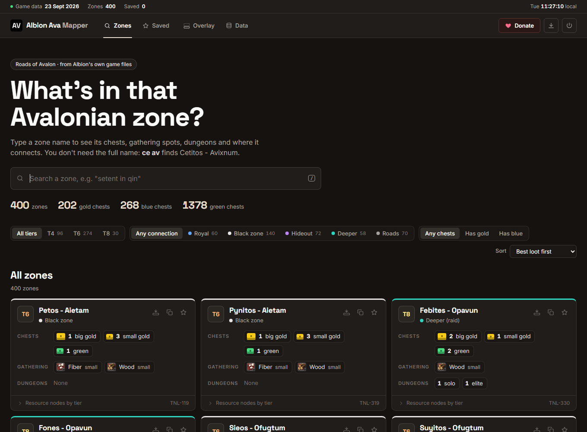
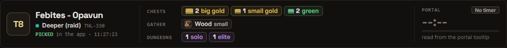

  

<h1 align="center">Albion Ava Mapper</h1>

Roads of Avalon zone finder and portal overlay for <b>Albion Online</b> on PC

  <a href="https://github.com/Tim1501/albion-ava-mapper/releases/latest"><b>Download the latest version</b></a>

## What it does

Found a Roads of Avalon portal and want to know if the zone behind it is worth it?
Hover the portal on the map, press **F8**, and a small overlay shows what's inside:
chests, gathering spots, dungeons, where it connects, and how long the portal stays open.

- **All 400 Avalonian zones** with their chests (green, blue, gold, small and big), gathering spots (type and size), solo/group/elite dungeons and connection (Royal, Black zone, Hideout, Deeper)
- **F8 reads the portal tooltip** under your mouse and shows that zone on the overlay, with a countdown until the portal closes
- **Overlay** a compact strip that fits in the black bars around an ultrawide (21:9) game. It's click-through, so it never gets in the way, and it shows up in your screenshots
- **Search** type part of a name: `ce av` finds *Cetitos - Avixnum*
- **Filter and sort** by tier, connection, gold or blue chests, best loot first
- **Copy for Discord** a short summary of a zone, with a Discord timer for when the portal closes
- **Saved zones**, **minimize to tray**, and an **update notice** when a new version is out

Everything comes from Albion's own game files (via [ao-bin-dumps](https://github.com/ao-data/ao-bin-dumps)), not from other sites.

## Before you start

> **English only.** F8 reads the text on your screen, so the game must be set to **English**.
> Searching zones works in any language.

> **"Windows protected your PC" / antivirus warning.** The app is free and not code-signed
> (signing costs money), so Windows SmartScreen and some antivirus programs warn about it.
> This is common for small, unsigned apps. If you trust it, click **More info > Run anyway**.
> The full source code is in this repository.

## Install

1. Download **Albion-Ava-Mapper-vX.Y.Z.zip** from the
   [latest release](https://github.com/Tim1501/albion-ava-mapper/releases/latest).
2. Right-click the zip > **Extract All**, and put the folder anywhere (e.g. your Documents).
3. Open the folder and double-click **Albion Ava Mapper.exe**.

Needs Windows 10 or 11 with Microsoft Edge (already installed on almost every PC).
Nothing else to install.

**Updating:** when a new version is out, an **Update** button shows in the app's header.
Download the new zip and extract it over the old folder; your saved zones and settings stay.

## How to use it

1. Start the app. The main window and the overlay open.
2. In Albion, open the map and **hover a Roads of Avalon portal** so its tooltip shows
   (*Road of Avalon to …*, *Closes in …*).
3. Press **F8**. The overlay shows that zone and the portal's countdown: green while over an
   hour is left, orange under an hour, red in the last 15 minutes.

| Key | What it does |
|---|---|
| **F8** | Read the portal tooltip under the mouse |
| **F9** | Unlock the overlay to drag it somewhere else; press again to lock it |

Both keys can be changed on the **Overlay** page. That page also has show/hide, reset
position, a test read, and **What it read**: if a read misses, it shows exactly what the app saw.

You can close the main window while you play; the app keeps running with the overlay.
The **⤓** button minimizes it to the tray (the "show hidden icons" area by the clock).

**Safe to use:** the app only looks at the pixels around your mouse when you press F8, like a
screenshot, and keeps that image in memory only. It never touches the game's memory, network
traffic or input.

## Where the numbers come from

| What | Game file |
|---|---|
| Zone names, tier, type, resources, dungeon and gathering markers | `cluster/world.xml` |
| Which camps each zone places | `cluster/TNL-*.cluster.xml` |
| Chests inside each camp | `templates/*PVE*.template.xml` |

Chest colours follow the game's own chest names: plain = **green**, *Veteran* = **blue**,
*Elite* = **gold**; *Small* / *Medium* = **small** / **big**. After an Albion patch, use
**Data > Update zone data** in the app.

## Run from source

Install [Python 3.10+](https://www.python.org/downloads/) and double-click
**Start from source.bat**. To build the release zip yourself:
`pip install -r requirements.txt pyinstaller`, then `python app/release.py 1.0.0 --build`.

## Support

I make this app as a hobby, in my free time. Bug fixes and new features can sometimes
take a while, thank you for your patience.

If the app helps you, please consider supporting it on PayPal:
**[paypal.me/DeepTak646](https://www.paypal.com/paypalme/DeepTak646)** (or the **Donate**
button in the app). Any amount is greatly appreciated.

Found a bug or have an idea? Message me on Discord: **@ChanaMasala**.

\- ChanaMasala

---

Not affiliated with Sandbox Interactive. Albion Online and its art are © Sandbox Interactive.
